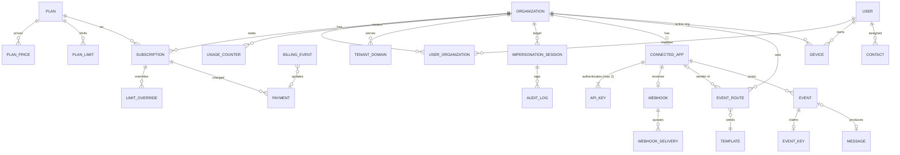

# Merged data model (polygin-saas)
<!-- One page. Cross-module merge of the saas, brand-ui, connect and apps G1 packs. Written 2026-11-19. Status: proposed. -->

## C Data: rules
- Every record and setting has one owner. Other modules link to it or read it. Nobody copies it (E02).
- "core" means the fork code that exists today. All GORM models live in `internal/models`. The owner column names the only package that writes the record.
- JSONB settings are split into namespaces. Each namespace has one owner (ADR-080).

## C Data: entities
| Entity | Mark | Owner (module, package) | Read by |
|---|---|---|---|
| Organization (tenant), `Name` | Reused | core `models` | all. `Name` is the tenant display name in the brand payload |
| Organization `access_state`, `access_reason`, `access_changed_at` | Extended | saas `internal/billing` (one mapping function) and `handlers/platform_*.go` | all, through `RequireAccess` |
| `Organization.Settings.branding.*` | Extended | saas `handlers/branding.go`. Shape set by brand-ui (ADR-083) | brand-ui, apps |
| `Organization.Settings.connect.*` (`dedupe_window_days`) | Extended | connect `internal/events` | connect |
| `Organization.Settings.push.preview` | Extended | apps `internal/push` | apps |
| User, `IsSuperAdmin`, `IsAvailable` | Reused | core `models` | saas, apps |
| `User.Settings.push.*` (`types`, `quiet_hours`, `preview`) | Extended | apps `internal/push` | apps |
| `User.Settings` `new_message_alerts`, `call_ringtone` | Reused | core (web client) | apps |
| UserOrganization | Reused | core `models` | saas (seat count), apps (device cleanup) |
| CustomRole, Permission | Extended | core `models/roles.go`. New resources: `billing`, `branding` (saas), `connected_apps` (connect) | all |
| AuditLog | Extended | core `internal/audit`. saas adds `impersonation_session_id` | saas, all writers (ADR-086) |
| APIKey | Extended | core `api_keys`. connect adds `connected_app_id`, `scopes` | connect, middleware |
| Webhook | Extended | core `webhooks`. connect adds `connected_app_id`, encrypted `secret` | connect |
| Template, WhatsAppAccount, Contact, Message, CallLog | Reused | core | connect (send), apps (badge, missed call), saas (counts) |
| ChatbotFlow | Extended | core chatbot. connect adds a template-reply entry point | connect |
| Stored file | Reused | core `internal/storage` | saas (logos) |
| Plan, PlanPrice, PlanLimit, Subscription, LimitOverride, UsageCounter, Payment, BillingEvent | New | saas `internal/billing` | apps and connect read through the billing service only |
| Limit key registry (code) | New | saas `internal/billing/keys.go` | connect, core send paths |
| ImpersonationSession | New | saas `handlers/platform_*.go` | audit, tenant Admin audit view |
| TenantDomain | New | saas `handlers/branding.go` | `embed.go`, TLS proxy ask endpoint |
| ConnectedApp, EventRoute, Event (intake log), EventKey, WebhookDelivery | New | connect `internal/events` | saas (count of `connected_apps` via a counter function) |
| Record type registry (code) | New | connect `internal/events/recordtypes.go` | plugins (through the docs) |
| Device (`push_devices`) | New | apps `internal/push` | apps only |
| Push type registry (code) | New | apps `internal/push/types.go` (ADR-084) | saas, connect, core event sites |
| Push job (Redis Stream `polygin:push`) | New, transient | apps `internal/push` | apps |
| Invite token, email verification token, impersonation token | New, transient | saas, in core `handlers/auth.go` | auth |
| App login code (Redis, 60 s) | New, transient | apps, in core `handlers/auth.go` | auth |
| Design tokens `--td-*` | Reused | `tonaldepth-core` | brand-ui |
| TonalDepth Vue components, `applyBranding`, contrast guard | Extended | brand-ui, in `tonaldepth-vue` | saas (branding screen), all views |
| UI shims, colour mode, `App.Name`, i18n strings, Polygin brand assets | Extended / New | brand-ui, fork `frontend/` and config | all |
| Origin marker on synced records | Reused | each business app | connect (arrives in the event) |

## Entities or settings that two packs both defined
| # | Item | Packs | Owner chosen | Why |
|---|---|---|---|---|
| 1 | Tenant branding record and payload | saas (ADR-010), brand-ui (ADR-022) | saas stores `Settings.branding`; brand-ui owns the payload shape and contrast guard | Storage sits with the tenant. The theme rule sits with the theme runtime (ADR-083) |
| 2 | Tenant name in branding ("product name", "display name") | saas, brand-ui | core `Organization.Name`, read only | A copy would drift. SAAS-07 does not let tenants rename Polygin |
| 3 | Plan limits and usage counts | saas (`PlanLimit`, `UsageCounter`), connect ("counts accepted events, reports to saas") | saas `internal/billing` | Connect consumes the meter. Its `Event` log is not a usage source (ADR-081) |
| 4 | Limit key names | saas `events_in`, `connected_apps`; connect `events_per_month`, `max_connected_apps`, `events_per_minute` | saas registry: `events_in`, `connected_apps`, new `events_per_min` | Billing owns keys (ADR-003) |
| 5 | Plan limit cache | saas (Redis, 60 s), connect (in process, 60 s) | saas billing service | One cache, one invalidation path |
| 6 | Tenant status | saas `access_state`, connect "tenant status" | saas `Organization.access_state` | ADR-002 already names one owner |
| 7 | Notification preferences and channels | apps (`User.Settings` keys), saas (billing notices), connect ("tell the Admin") | apps `internal/push` type registry and `push.*` keys; email sender with saas | One rule set for who gets what (ADR-084) |
| 8 | `push_preview` at two levels | apps (org and user, same key name) | apps, under the `push.*` namespace in each | Same owner; clearer keys (ADR-080) |
| 9 | AGPL footer link | saas says brand-ui; brand-ui says saas | brand-ui shell footer | It is shell UI; ADR-010 already said so |
| 10 | Internal events for push | connect (`connect.*` events), apps (push jobs, "if connect adds a bus") | apps `push.Enqueue` and type registry | No event bus. Each event site calls one function |
| 11 | Credentials for non-human callers | connect (scoped API keys), apps (device secret) | connect owns API keys; apps owns device secrets, stream only | A device secret calls one route. It is not an API key (ADR-085) |
