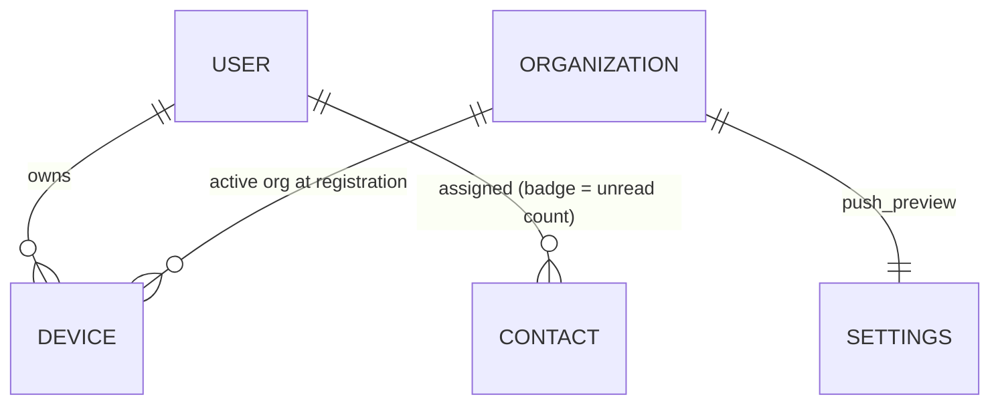
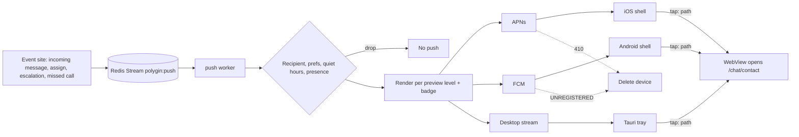

# G1 pack: apps (polygin-saas)
<!-- Covers APP-01 to APP-04. Write-only pack. Nothing is built. -->

## A Architecture Vision
- Goal: push, a Tauri desktop helper and Capacitor phone apps for Agents and Admins of every tenant.
- Constraints: AGPL core; small installers; low memory; web-only buying (D4); no GitHub Actions (E12); new repos need approval (E23).
- Code facts (read 2026-11-19):
  - `/ws` upgrades first, then needs `{"type":"auth","payload":{"token":<jwt>}}` within 5 s. The token comes from `GET /api/auth/ws-token` (30 s, org-resolved).
  - Login sets cookies only: `whm_access` (httpOnly, path `/api`), `whm_refresh` (httpOnly, single-use JTI in Redis, rotated), `whm_csrf` (double submit). SameSite=Lax. The body holds no tokens.
  - Middleware also accepts `Authorization: Bearer` and `X-API-Key`; both skip CSRF.
  - Events exist: `new_message` (to whole org), `agent_transfer`, `agent_transfer_assign`, `transfer_escalation`, `call_incoming`, `call_transfer_waiting`, call end states. `CallStatusMissed` exists.
  - The web client alerts only the assigned user on incoming messages, gated by `new_message_alerts`. Calls ring only users online on the hub.
  - The hub is in memory, one process. Redis pub/sub carries only campaign stats.
  - Finding for core: `validateWSTokenFn` accepts any valid JWT, including refresh tokens. It does not check `Subject: ws`.

## B Business
- Capabilities: notify an Agent of new work while away; answer from phone or desktop; ring calls on desktop; show plan status.
- Roles: Agent (receives, replies); Admin (sets tenant preview privacy); Superadmin (owns store accounts and releases).
- Processes: install, sign in, register device, receive push, tap to open conversation, sign out (device removed).

## C Data
| Entity | Mark | Owner | Notes |
|---|---|---|---|
| Device (`push_devices`) | New | fork `internal/push` | user, org, platform, transport (apns, fcm, desktop), token (encrypted), app version, last_seen_at. Unique (transport, token). Desktop rows add a secret hash |
| User, UserOrganization | Reused | fork `models` | Link only |
| User.Settings notification keys | Extended | fork `models.User` | Keep `new_message_alerts`, `call_ringtone`. Add `push` (per type on or off), `quiet_hours` (start, end, tz), `push_preview` (may only lower the tenant level) |
| Organization.Settings `push_preview` | Extended | fork `models.Organization` | `hidden`, `sender` (default), `full` |
| Contact (`AssignedUserID`, `IsRead`) | Reused | fork `models.Contact` | Recipient rule and badge source. No badge table |
| Call log status `missed` | Reused | fork `models/call.go` | Missed-call push |
| Push job | New, transient | fork `internal/push` | Redis Stream `polygin:push`, same pattern as `internal/queue` |
| App login code | New, transient | fork `handlers/auth.go` | Redis key, 60 s, single use, for SSO in the system browser |
| Plan and subscription status | Reused | saas `billing` | Read only |
| Tenant branding | Reused | saas (SAAS-07) | Read after login |

## C Application
| Capability | Placement | Generic or customer | Why |
|---|---|---|---|
| Device API, recipient rules, prefs, quiet hours, badge, privacy render, FCM, APNs, desktop stream | fork `internal/push` + `handlers/push.go` (new package) | Generic | Server owns rules once for all clients. Alternative: a separate push service; rejected, it adds a deploy and a DB link |
| Enqueue calls at event sites | fork `messages.go`, `agent_transfers.go`, `sla_processor.go`, `call_webhook.go` (extend) | Generic | Typed events beat parsing generic hub payloads |
| Native bridge adapter (detect shell, pass token, hide buy buttons) | fork `frontend/src/native/` (new folder) | Generic | Uses `window.Capacitor` and `window.__TAURI__` globals. No npm dependency added |
| `apple-app-site-association`, `assetlinks.json` | fork static route (extend) | Generic | Universal links need them on `app.polyg.in` |
| Desktop helper | new repo `polygin-desktop` (approval) | Generic | Tray, notifications, calls, update. Alternative: monorepo `polygin-apps` (ADR-061) |
| Phone apps | new repo `polygin-mobile` (approval) | Generic | Push, deep links, camera upload, plan status |

- No customer app. Every tenant gets the same apps; branding comes from SAAS-07 at runtime.
- Desktop helper does: tray with unread count and available toggle (reuses `User.IsAvailable`), native notifications, start at login (toggle), `polygin://` and https deep links, single instance, call ringing, signed auto-update.
- Desktop helper does not: hold business UI, cache messages, call business APIs itself, own auth, own notification rules or ringtone settings.
- Phone apps: APNs and FCM push; deep link to `/chat/<contact_id>`; camera, gallery and voice notes through the web file input and `getUserMedia`; no background socket (push only; refetch on resume); plan status read only.
- WhatsApp calling is out of mobile release 1 (ADR-064). Phones get a missed-call push.

## D Technology
- Shells load `https://app.polyg.in` in the system WebView; they bundle no AGPL code (ADR-060). One host serves every tenant, so custom domains need no app change (ADR-066).
- Login: the web login page runs inside the WebView, so first-party cookies work unchanged. SSO opens the system browser, then a one-time code returns through the deep link.
- Push: FCM HTTP v1 via existing `golang.org/x/oauth2`; APNs HTTP/2 with ES256 via existing `golang-jwt`. No new Go dependency.
- Desktop transport: `/api/push/desktop/stream`, authenticated by the device secret. It carries only rendered notifications and badge counts, never the org event feed.
- Token life: register on every start and OS token change (upsert). Delete on sign-out, APNs 410 or `BadDeviceToken`, FCM `UNREGISTERED`, user deactivation, removal from org, password reset. Prune after 60 days unseen.
- Delivery rules: skip if type is off; quiet hours send silent (badge only); if the user is online on the hub, phone push waits 60 s and drops if the contact is read. Collapse per contact.
- Payload: event type, org id, contact id, path, badge, collapse key, and the title and body allowed by the preview level. Never phone numbers, media or message ids (ADR-063).
- Targets: desktop installer under 15 MB; tray idle under 60 MB with the WebView unloaded; phone download under 20 MB. "Ready for calls" keeps the WebView loaded (ADR-064).
- Linux: WebKitGTK lacks reliable WebRTC, so Linux calls open in the default browser.
- Builds (ADR-067): Mac with Xcode for iOS and macOS (sign, notarise); home cluster pods for Android and Linux; a Windows machine for MSI/NSIS.
- Prerequisites the user supplies: Apple Developer Program (organisation, D-U-N-S), Developer ID and Distribution certs, APNs `.p8` key, App Store Connect API key; Google Play organisation account, upload key, Firebase project and service account; Windows code-signing cert or Azure Trusted Signing; Tauri updater key pair; privacy policy and support URLs; a demo tenant for store review. All secrets live in env vars (E10).
- Release: bump version, build, sign, notarise, TestFlight and Play internal track, review, staged rollout. Desktop gets a signed update manifest.

## Provides / Needs
- Provides: `internal/push` API (register, list, delete devices; enqueue event); push prefs keys; native bridge adapter; shells.
- Needs from `brand-ui`: responsive views at 360 px, safe-area insets, touch targets of 44 px, and a "Your devices" settings view.
- Needs from `saas`: a plan status API; billing views hide buy actions when the adapter reports a phone shell; login on `app.polyg.in` for every tenant; branding API.
- Needs from `connect`: stable internal event types for message, assignment, escalation and missed call. Push subscribes if `connect` adds an event bus.

## Decisions (ADRs)
- ADR-060 shells load the hosted web app; ADR-061 two repos; ADR-062 push inside the fork; ADR-063 payload privacy; ADR-064 calling scope; ADR-065 web-only buying; ADR-066 app login; ADR-067 build machines. See `../../adr/`.

## Requirement coverage
| Req ID | Mark | Owner |
|---|---|---|
| APP-01 | new | fork `internal/push` |
| APP-02 | new | `polygin-desktop` (approval) |
| APP-03 | new | `polygin-mobile` (approval) + fork bridge adapter |
| APP-04 | new | `polygin-mobile` shows saas plan status; no in-app purchase |

## Open questions
1. Approve two repos (`polygin-desktop`, `polygin-mobile`), or one monorepo `polygin-apps`?
2. Approve the hosted-web-app shell (ADR-060), with a lawyer to confirm the AGPL position?
3. Do you have a Windows machine for builds, and which code-signing route?
4. Where should desktop installers and the update manifest live?
5. Are per-tenant white-label store apps out of release 1, as assumed?
6. Do the Apple and Google organisation accounts exist yet?
