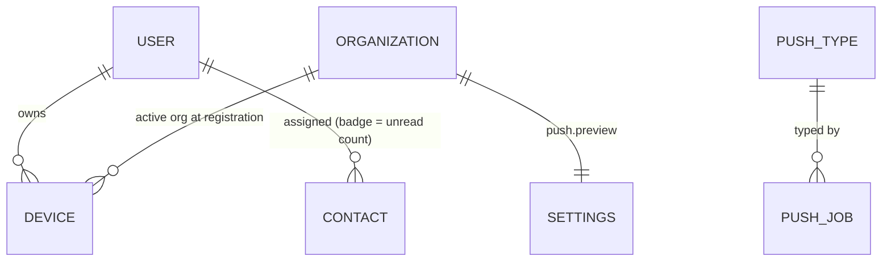
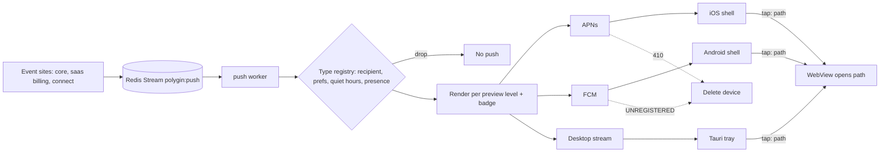

# G1 pack: apps (polygin-saas)
<!-- One page. Covers APP-01 to APP-05, SEC-03, SEC-12, SEC-13. Write-only pack. Nothing is built. Merged 2026-11-19 with `../../data-model.md` and `../../contracts.md`. -->

## A Architecture Vision
- Goal: push, a Tauri desktop helper and Capacitor phone apps for Agents and Admins of every tenant.
- Constraints: AGPL core; small installers; low memory; web-only buying (D4); no GitHub Actions (E12); new repos need approval (E23).
- Key code facts: login uses cookies only (`whm_access` path `/api`); `/ws` needs a 30 s ws-token; the hub is in memory. `validateWSTokenFn` accepts refresh tokens (SEC-03).
- Detailed contracts: `contract.md` (code facts, push contract, bridge adapter, builds and prerequisites).

## B Business
- Capabilities: notify an Agent of new work while away; alert an Admin of failed integrations and billing changes; answer from phone or desktop; ring calls on desktop; show plan status.
- Roles: Agent (receives, replies); Admin (sets tenant preview privacy; gets Admin alerts); Superadmin (owns store accounts and releases).
- Processes: install, sign in, register device, receive push, tap to open conversation, sign out (device removed).

## C Data
| Entity | Mark | Owner | Notes |
|---|---|---|---|
| Device (`push_devices`) | New | fork `internal/push` | user, org, platform, transport (apns, fcm, desktop), token (encrypted), app version, last_seen_at. Unique (transport, token). Desktop rows add a secret hash (SEC-13) |
| Push type registry | New (code) | fork `internal/push/types.go` | Types and recipient rules for all modules (ADR-084) |
| User, UserOrganization | Reused | fork `models` | Link only |
| `User.Settings.push.*` | Extended | fork `internal/push` | `types` (per type on or off), `quiet_hours` (start, end, tz), `preview` (may only lower the tenant level). Namespace per ADR-080 |
| `User.Settings` `new_message_alerts`, `call_ringtone` | Reused | core web client | Read only |
| `Organization.Settings.push.preview` | Extended | fork `internal/push` | `hidden`, `sender` (default), `full` |
| Contact (`AssignedUserID`, `IsRead`) | Reused | fork `models.Contact` | Recipient rule and badge source. No badge table |
| Call log status `missed` | Reused | fork `models/call.go` | Missed-call push |
| Push job | New, transient | fork `internal/push` | Redis Stream `polygin:push`, same pattern as `internal/queue` |
| App login code | New, transient | fork `handlers/auth.go` | Redis key, 60 s, single use, for SSO in the system browser |
| Plan and subscription status | Reused | saas `internal/billing` | Read through `GET /api/billing/summary` |
| Tenant branding | Reused | saas (SAAS-07) | Read through `GET /api/branding` |

## C Application
| Capability | Placement | Generic or customer | Why |
|---|---|---|---|
| Device API, type registry, recipient rules, prefs, quiet hours, badge, privacy render, FCM, APNs, desktop stream | fork `internal/push` + `handlers/push.go` (new package) | Generic | Server owns rules once for all clients. Alternative: a separate push service; rejected, it adds a deploy and a DB link |
| Enqueue calls at event sites | fork `messages.go`, `agent_transfers.go`, `sla_processor.go`, `call_webhook.go` (extend) | Generic | Typed events beat parsing generic hub payloads. saas and connect call `push.Enqueue` too |
| Device cleanup hooks | fork user and auth handlers (extend) | Generic | Deactivation, removal from org, password reset |
| WebSocket token check (SEC-03) | fork `validateWSTokenFn` (extend) | Generic | Accept only `Subject: ws` tokens |
| "Your devices" and push preference views | fork `views/settings/` (new), TonalDepth | Generic | Polygin-only screen; brand-ui builds no new screens (ADR-024) |
| Native bridge adapter (detect shell, `data-platform`, pass token, hide buy buttons) | fork `frontend/src/native/` (new folder) | Generic | Uses `window.Capacitor` and `window.__TAURI__` globals. No npm dependency added |
| `apple-app-site-association`, `assetlinks.json` | fork static route (extend) | Generic | Universal links need them on `app.polyg.in` |
| Desktop helper | new repo `polygin-desktop` (approval) | Generic | Tray, notifications, calls, update. Alternative: monorepo `polygin-apps` (ADR-061) |
| Phone apps | new repo `polygin-mobile` (approval) | Generic | Push, deep links, camera upload, plan status |

- No customer app. Every tenant gets the same apps; branding comes from SAAS-07 at runtime.
- Desktop helper does: tray with unread count and available toggle (reuses `User.IsAvailable`), native notifications, start at login, `polygin://` and https deep links, single instance, call ringing, signed auto-update.
- Desktop helper does not: hold business UI, cache messages, call business APIs itself, own auth, own notification rules or ringtone settings.
- Phone apps: APNs and FCM push; deep link to `/chat/<contact_id>`; camera, gallery and voice notes through the web file input; no background socket; plan status read only. No WhatsApp calling in release 1 (ADR-064).

## D Technology
- Shells load `https://app.polyg.in` in the system WebView; they bundle no AGPL code (ADR-060). One host serves every tenant (ADR-066).
- Login: the web login page runs inside the WebView, so first-party cookies work unchanged. SSO opens the system browser, then a one-time code returns through the deep link.
- Push: FCM HTTP v1 via existing `golang.org/x/oauth2`; APNs HTTP/2 with ES256 via existing `golang-jwt`. No new Go dependency.
- Builds on our own machines (ADR-067). Targets and prerequisites in `contract.md`.

## Provides / Needs (checked in `../../contracts.md`)
- Provides: `push.Enqueue` and the type registry (ADR-084); device API; `push.preview` and `push.*` prefs; bridge adapter with `data-platform` and the phone-shell flag; a purge function for devices; shells.
- Needs from `brand-ui`: responsive views at 360 px, safe-area insets, 44 px touch targets, brand assets.
- Needs from `saas`: `GET /api/billing/summary`; billing views that honour the phone-shell flag; login on `app.polyg.in` for every tenant; `GET /api/branding`.
- Needs from `connect`: nothing beyond its `push.Enqueue` calls. Agent events come from core sites that apps extends.

## Decisions (ADRs)
- ADR-060 shells load the hosted web app; ADR-061 two repos; ADR-062 push inside the fork; ADR-063 payload privacy; ADR-064 calling scope; ADR-065 web-only buying; ADR-066 app login; ADR-067 build machines. Cross-cutting: ADR-080 to ADR-087. See `../../adr/`.

## Requirement coverage
| Req ID | Mark | Owner |
|---|---|---|
| APP-01 | new | fork `internal/push` |
| APP-02 | new | `polygin-desktop` (approval) |
| APP-03 | new | `polygin-mobile` (approval) + fork bridge adapter |
| APP-04 | new | `polygin-mobile` shows saas plan status; no in-app purchase |
| APP-05 | new | fork `internal/push` prefs and `views/settings/` |
| SEC-03, SEC-12, SEC-13 | extend / new | fork `validateWSTokenFn`; `internal/push` |

## Open questions
See `../../open-questions.md`, group apps (A1 to A6).
