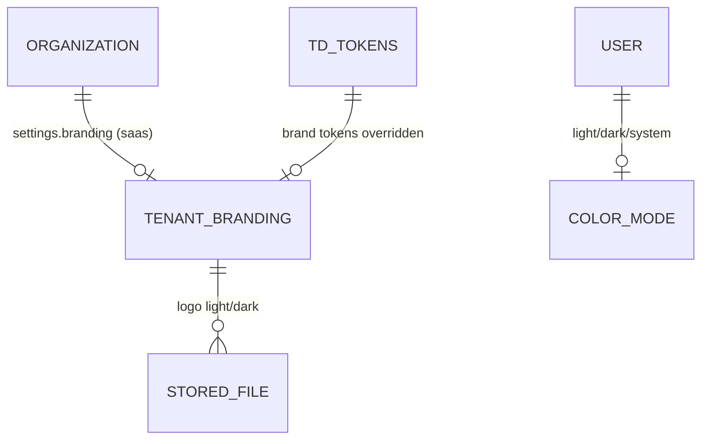
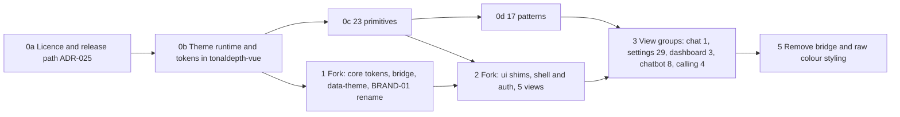
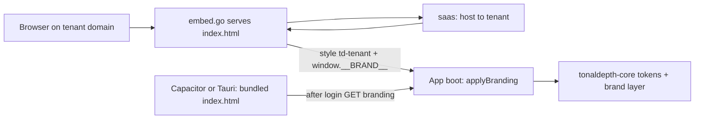

# G1 pack: brand-ui (polygin-saas)
<!-- One page. Mermaid diagrams. Sections labelled with their TOGAF phase. Written 2026-11-19. -->

## A Architecture Vision
- Scope: BRAND-01 (rename to Polygin) and BRAND-02 (redesign 50 views with TonalDepth, light and dark). See `../../requirements.md`.
- This module also delivers the theme contract that SAAS-07 (per-tenant logo, colours, domain) uses.
- Stakeholders: Superadmin, Admin, Agent; the saas, mobile (APP-03) and desktop (APP-02) modules.
- Constraints: core stays AGPL-3.0. Upstream merges must stay workable. D1: build out `tonaldepth-vue` on Reka UI as wave 0.
- UI rule (copy into every UI brief): build every UI with TonalDepth (`/Volumes/Extreme/Coding/tonaldepth`, npm `@mithtech-bengaluru/tonaldepth-*`). Use its tokens, Mithtech colours, subtle claymorphism, light and dark modes. Use no raw colours and no outline-only depth.

## B Business
- Capabilities: Polygin product identity; one TonalDepth look in light and dark; tenant white-label look; one frontend for web, phone and desktop.
- Roles: all three roles see the redesign. Admin sets tenant branding (saas module owns that screen).
- Today: 50 views, 20 shared components, 5 layout parts, 30 of 48 shadcn-vue primitives in use. 1,072 raw colour classes and 585 `light:` variants in 101 files.

## C Data
| Entity | Reused / Extended / New | Owner | Notes |
|---|---|---|---|
| Design tokens (`--td-*`, light and dark) | Reused | `tonaldepth-core` | Link only. Never copy values into the fork |
| TonalDepth Vue components | Extended (5 to 45) | `tonaldepth-vue`, tonaldepth repo | Wave 0 |
| UI primitives `frontend/src/components/ui/*` | Extended | fork frontend | Become thin shims over `tonaldepth-vue` (ADR-020) |
| Colour mode preference | Extended | fork `composables/useColorMode` | Also sets `data-theme` (ADR-022) |
| Product name | Extended | fork config `App.Name` | Default becomes "Polygin" |
| UI strings | Extended | `frontend/src/i18n/locales/*.json` (6 files) | Name becomes an `{appName}` parameter |
| Polygin brand assets (logo, favicon, icon) | New | fork `frontend/src/assets/brand/` | Shells derive icons at build time |
| Tenant branding (logo light/dark, brand colour, display name, domain) | New | `Organization.Settings.branding`, saas module | brand-ui reads it only |
| Tenant logo files | Reused | fork `internal/storage` | Stored by saas |

## C Application
Inventory: 30 primitives in use. 7 map to existing TonalDepth Vue parts. 23 primitives and 17 patterns are to build: 40 in total.

| Group | Fork primitives in use | Exists in tonaldepth-vue | To build (React reference) |
|---|---|---|---|
| Actions | button (80 imports) | TdButton | icon-button |
| Form | input, textarea, label, select, switch, checkbox, radio-group, command, range-calendar | TdInput, TdTextarea, TdFormField | select, switch, checkbox, radio-group, combobox, date-range-picker |
| Display | badge, tag-badge, card, avatar, separator, skeleton, spinner, progress, alert | TdBadge (tag variant), TdCard | avatar, divider, skeleton, spinner, progress, alert |
| Overlay | dialog, alert-dialog, popover, tooltip, dropdown-menu | none | dialog, alert-dialog, popover, tooltip, dropdown-menu, toast |
| Structure | tabs, accordion, collapsible, breadcrumb, scroll-area, table | none | tabs, accordion, collapsible, breadcrumbs, scroll-area, table, pagination |
| Patterns | `shared/`, `layout/`, flow and chart parts | none | application-shell, bottom-nav, theme-toggle, page-state, search-bar, kpi-card, chart-container, canvas, canvas-node, canvas-panel, upload, file-preview, timeline, color-picker |

| Capability | Placement | Generic or product | Why (alternative) |
|---|---|---|---|
| 40 Vue components and the theme runtime (`applyBranding`, contrast guard) | tonaldepth `components/packages/vue` | Generic | Every Mithtech Vue app reuses them (alt: fork `components/ui`, rejected: not reusable) |
| shadcn-API shims | fork `frontend/src/components/ui/*` | Product | Views keep their imports; small upstream diffs (alt: rewrite imports in 50 views) |
| Token bridge (Tailwind colours to `--td-*`) | fork `tailwind.config.cjs`, `assets/index.css` | Product | Temporary; removed in step 5 |
| View redesign, in place | fork `frontend/src/views/**`, `components/**` | Product | Same paths as upstream (ADR-024) |
| Rename | fork frontend, i18n, config default, Makefile, Docker, goreleaser, `docs/` | Product | ADR-023 |
| Tenant theme injection | fork `internal/frontend/embed.go` (extend) | Product, built by saas | It already injects `__BASE_PATH__` into `index.html` |

Order of work:

- Chat goes first in step 3. The mobile inbox (APP-03) needs it.
- Settings comes next. Its 29 list and detail views prove the page patterns.
- Flow builders come last. They need the canvas skin over vue-flow.

## D Technology
- Stack: Vue 3.5.25, Vite 7, Tailwind 3.4, Reka UI 2.7 (a peer dependency of `tonaldepth-vue`), lucide icons kept, vue-flow and chart.js kept and skinned with tokens. TdToast replaces vue-sonner.
- Tailwind and tokens: step 1 points Tailwind colour names at `--td-*` tokens. Untouched views then render in TonalDepth colours. Each migrated view group must pass a no-raw-colour check. Step 5 removes the palettes, the `light:` variant, the `.dark/.light` CSS and the shadcn HSL variables. Tailwind stays for layout and spacing only (ADR-021).
- Theme: `data-theme="light|dark"` on `<html>`; no attribute means system. Tenant overrides change only `--td-brand`, `--td-brand-deep` and `--td-brand-text`, per theme, after a contrast check (ADR-022).
- Shells: minimum width 360 px. Bottom nav below 768 px. Safe-area tokens from `env(safe-area-inset-*)`. Tauri title-bar inset and drag region. `data-platform` on `<html>`. RTL through logical CSS properties, for the Arabic locale (ADR-026).
- Upstream: in-place redesign, script blocks untouched, module path and `cmd/whatomate` kept (ADR-023, ADR-024).

## Provides / Needs
- Provides to saas: the branding payload shape, `applyBranding()`, the contrast rule, a TdColorPicker, and a footer slot in the shell for SAAS-08.
- Provides to mobile and desktop: one responsive shell, safe-area and title-bar tokens, the `data-platform` hook, and brand assets.
- Needs from saas: `Organization.Settings.branding`, host-to-tenant lookup, a public branding endpoint, and the injection in `embed.go`.
- Needs from tonaldepth: the wave 0 release of `tonaldepth-vue`. Its HANDOFF blocks releases until the alpha.42 to alpha.51 version gap is recovered.

## Decisions (ADRs)
- ADR-020 shadcn-API shims over tonaldepth-vue. ADR-021 Tailwind for layout only. ADR-022 theme and tenant brand layer. ADR-023 rename scope. ADR-024 upstream merge strategy. ADR-025 TonalDepth licence for the AGPL frontend (Proposed). ADR-026 responsive and shell contract. See `../../adr/`.

## Requirement coverage
| Req ID | exists / extend / new | Owner |
|---|---|---|
| BRAND-01 | extend | fork frontend, i18n, config default, build files, docs |
| BRAND-02 | extend | `tonaldepth-vue` (wave 0) and fork `frontend/` |
| SAAS-07 | new (enabled here) | saas module; uses the brand-ui theme contract |
| SAAS-08 | new (slot here) | saas module; footer slot in the shell |

## Open questions
1. Licence: TonalDepth packages are `UNLICENSED`, but the frontend is AGPL. May core and vue ship under MIT (Recommended), or AGPL-3.0?
2. Source access: AGPL users must be able to build. Publish the two packages to public npm (Recommended), or vendor them in the fork?
3. Release: does wave 0 wait for the tonaldepth version-gap recovery (Recommended), or release the Vue package alone?
4. White label: may a tenant replace the name "Polygin" in the UI, or only the logo and colours (Recommended)?
5. Flow builders on phones: read-only notice (Recommended), or hidden?
