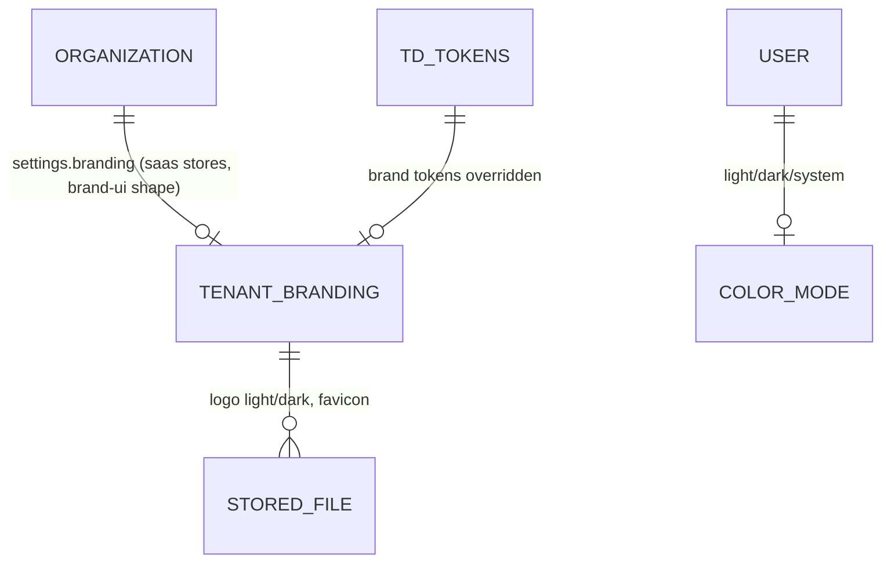
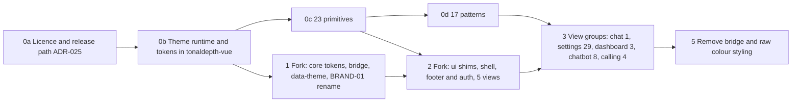
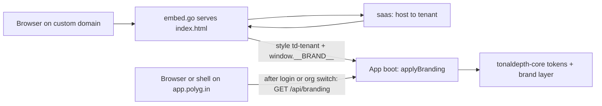

# G1 pack: brand-ui (polygin-saas)
<!-- One page. Mermaid diagrams. Sections labelled with their TOGAF phase. Written 2026-11-19. Merged 2026-11-19 with `../../data-model.md` and `../../contracts.md`. -->

## A Architecture Vision
- Scope: BRAND-01 (rename to Polygin), BRAND-02 (redesign 50 views with TonalDepth, light and dark), BRAND-03 (responsive shell). See `../../requirements.md`.
- This module also delivers the theme contract that SAAS-07 uses, and the SAAS-08 footer.
- Stakeholders: Superadmin, Admin, Agent; the saas and apps modules.
- Constraints: core stays AGPL-3.0. Upstream merges must stay workable. D1: build out `tonaldepth-vue` on Reka UI as wave 0.
- UI rule (copy into every UI brief): build every UI with TonalDepth (`/Volumes/Extreme/Coding/tonaldepth`, npm `@mithtech-bengaluru/tonaldepth-*`). Use its tokens, Mithtech colours, subtle claymorphism, light and dark modes. Use no raw colours and no outline-only depth.
- Detailed contracts: `contract.md` (branding payload, shell contract, component inventory, rename surface).

## B Business
- Capabilities: Polygin product identity; one TonalDepth look in light and dark; tenant logo and colours; one frontend for web, phone and desktop.
- Roles: all three roles see the redesign. Admin sets tenant branding (saas owns that screen).
- Today: 50 views, 20 shared components, 5 layout parts, 30 of 48 shadcn-vue primitives in use. 1,072 raw colour classes and 585 `light:` variants in 101 files.

## C Data
| Entity | Reused / Extended / New | Owner | Notes |
|---|---|---|---|
| Design tokens (`--td-*`, light and dark) | Reused | `tonaldepth-core` | Link only. Never copy values into the fork |
| TonalDepth Vue components, `applyBranding`, contrast guard | Extended (5 to 45) | `tonaldepth-vue`, tonaldepth repo | Wave 0 |
| UI primitives `frontend/src/components/ui/*` | Extended | fork frontend | Become thin shims over `tonaldepth-vue` (ADR-020) |
| Colour mode preference | Extended | fork `composables/useColorMode` | Also sets `data-theme` (ADR-022). No new server field |
| Product name | Extended | fork config `App.Name` | Default becomes "Polygin". Same for every tenant (ADR-083) |
| UI strings | Extended | `frontend/src/i18n/locales/*.json` (6 files) | Name becomes an `{appName}` parameter |
| Polygin brand assets (logo, favicon, icon) | New | fork `frontend/src/assets/brand/` | Shells derive icons at build time |
| Branding payload shape | New (contract) | brand-ui | Stored by saas in `Organization.Settings.branding` (ADR-083) |
| Tenant display name | Reused | core `Organization.Name` | Read only. Not stored in branding |
| Tenant logo files | Reused | fork `internal/storage` | Stored by saas |

## C Application
| Capability | Placement | Generic or product | Why (alternative) |
|---|---|---|---|
| 40 Vue components and the theme runtime (`applyBranding`, contrast guard) | tonaldepth `components/packages/vue` | Generic | Every Mithtech Vue app reuses them (alt: fork `components/ui`, rejected: not reusable) |
| shadcn-API shims | fork `frontend/src/components/ui/*` | Product | Views keep their imports; small upstream diffs (alt: rewrite imports in 50 views) |
| Token bridge (Tailwind colours to `--td-*`) | fork `tailwind.config.cjs`, `assets/index.css` | Product | Temporary; removed in step 5 |
| View redesign, in place | fork `frontend/src/views/**`, `components/**` | Product | Same paths as upstream (ADR-024). New screens belong to their module |
| Rename | fork frontend, i18n, config default, Makefile, Docker, goreleaser, `docs/` | Product | ADR-023, ADR-087 |
| Shell footer with AGPL link and build commit (SAAS-08) | fork `components/layout/` | Product | Shell UI; ADR-083 |
| Tenant theme injection | fork `internal/frontend/embed.go` (extend) | Product, built by saas | Custom domains only; `app.polyg.in` uses `GET /api/branding` |

Order of work:

- Chat goes first in step 3. The mobile inbox (APP-03) needs it. Settings comes next. Flow builders come last.

## D Technology
- Stack: Vue 3.5.25, Vite 7, Tailwind 3.4, Reka UI 2.7 (a peer dependency of `tonaldepth-vue`), lucide icons kept, vue-flow and chart.js kept and skinned with tokens. TdToast replaces vue-sonner.
- Tailwind and tokens: step 1 points Tailwind colour names at `--td-*` tokens. Each migrated view group must pass a no-raw-colour check. Step 5 removes the old palettes. Tailwind stays for layout and spacing only (ADR-021).
- Theme: `data-theme="light|dark"` on `<html>`; no attribute means system. Tenant overrides change only the three brand tokens, per theme, after the contrast guard (ADR-022).
- Shells load the hosted app (ADR-060). They get the same views, footer and branding flow as a browser.

## Provides / Needs (checked in `../../contracts.md`)
- Provides to saas: the branding payload shape, `applyBranding()`, the contrast guard, TdColorPicker, and the shell footer.
- Provides to apps: one responsive shell, safe-area and title-bar tokens, the `data-platform` hook, and brand assets.
- Provides to connect: names per ADR-087.
- Needs from apps: the bridge adapter sets `data-platform`. TdWindowControls waits on open question X1.
- Needs from saas: `Organization.Settings.branding`, host lookup, `GET /api/public/branding`, `GET /api/branding`, the injection in `embed.go`.
- Needs from tonaldepth: the wave 0 release of `tonaldepth-vue`. Its HANDOFF blocks releases until the alpha.42 to alpha.51 version gap is recovered.

## Decisions (ADRs)
- ADR-020 shadcn-API shims. ADR-021 Tailwind for layout only. ADR-022 theme and tenant brand layer. ADR-023 rename scope. ADR-024 upstream merge strategy. ADR-025 TonalDepth licence (Proposed). ADR-026 responsive and shell contract. Cross-cutting: ADR-080 to ADR-087. See `../../adr/`.

## Requirement coverage
| Req ID | exists / extend / new | Owner |
|---|---|---|
| BRAND-01 | extend | fork frontend, i18n, config default, build files, docs |
| BRAND-02 | extend | `tonaldepth-vue` (wave 0) and fork `frontend/` |
| BRAND-03 | extend | fork `frontend/` layout and `tonaldepth-vue` patterns (ADR-026) |
| SAAS-07 | new (theme part) | brand-ui payload and guard; saas storage, endpoints and screen |
| SAAS-08 | new | brand-ui shell footer |

## Open questions
See `../../open-questions.md`, group brand-ui (B1 to B5). B4 is answered by SAAS-07.
