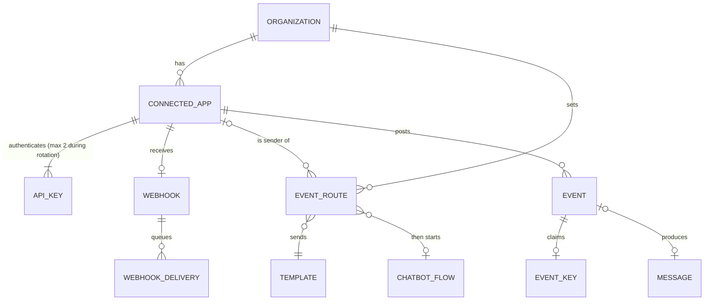
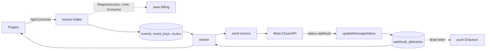

# G1 pack: connect (polygin-saas)
<!-- One page. Requirement IDs INT-01 to INT-05, plus the plugin contract for INT-06 to INT-09. Write only; nothing is built. Merged 2026-11-19 with `../../data-model.md` and `../../contracts.md`. -->

## A Architecture Vision
- Scope: confirmed bullets in `../../requirements.md` (Confirmed scope). Stakeholders: Superadmin, Admin, plugin authors.
- Constraints: the core stays AGPL-3.0. Plugins are closed programs that use only public API v1. A message goes out once.
- Code checked: API keys inherit the creator's role and have no scopes (`middleware.go:196`). Webhooks retry 3 times in a goroutine and lose the delivery on restart (`webhook_dispatch.go:138`). No `message.status` webhook exists. Webhook secrets are stored in plain text. These are SEC-04 to SEC-07.
- Detailed contracts: `contract.md` (intake, guards, outbound webhooks, compatibility, plugin rules).

## B Business
- Capabilities: connect a business app; send business events; turn an event into a WhatsApp message; return replies and delivery status; drop duplicates.
- Roles: Admin connects, scopes and revokes apps, and sets routes (permission `connected_apps`). Superadmin sees usage. A plugin acts as a service principal.
- Process: the app emits an event, then Polygin checks it, then sends one template, then reports status back to the app.

## C Data
| Entity | Reused / Extended / New | Owner | Notes |
|---|---|---|---|
| Organization (tenant), `Settings.connect.*` | Reused | core `models.Organization`; namespace owned by connect (ADR-080) | `dedupe_window_days` |
| Plan limits, usage meter | Reused | saas `internal/billing` | Keys `events_in`, `events_per_min`, `connected_apps`. Connect calls `Consume`; it keeps no count or cache (ADR-081) |
| APIKey | Extended | core `api_keys` | Add `connected_app_id`, `scopes`. App keys use scopes only (ADR-085) |
| Webhook | Extended | core `webhooks` | Add `connected_app_id`. Encrypt `secret` with `internal/crypto`. New events |
| WebhookDelivery | New | connect | Durable outbox: attempts, next try, `dead` state |
| ConnectedApp | New | connect | Tenant, app type, name, status (active, paused, revoked), last seen |
| EventRoute | New | connect | One row per tenant + record type + event. Sender app (guard 1), template, parameter map, optional flow |
| Event | New | connect | Intake log: outcome, state, key hash, `message_id`. Not a usage source |
| EventKey | New | connect | Duplicate window (guard 2). Unique on tenant + key hash |
| Record type registry | New (code) | connect `recordtypes.go` | Key fields per record type. Platform-owned |
| Template, WhatsAppAccount, Contact, Message | Reused | core | Link only. Contact is found or created by phone |
| ChatbotFlow | Extended | core chatbot | Start a flow on the reply to an event's template |
| AuditLog | Reused | core `internal/audit` | Connect, revoke, rotate, scope, route, replay, resend (ADR-086) |
| Origin marker on synced records | Reused | each business app | Polygin stores no copy. It arrives in the event |

## C Application
| Capability | Placement | Generic or customer | Why |
|---|---|---|---|
| Connected apps API and page (INT-03) | `internal/events`, `handlers/connected_apps.go`, `views/settings/ConnectedAppsView.vue` | Generic core | Every tenant needs it. Alternative: extend the API keys page (rejected: it hides webhooks and routes) |
| Event intake, guards, routing (INT-04, INT-05) | New package `internal/events`, thin handler `handlers/events.go` | Generic core, setting-driven | G0 named this package. Alternative: all in `handlers` (rejected: already 90 files) |
| Send for an event | Extract the core of `SendTemplateMessage` (`messages.go:662`) into one internal function | Generic core | One send path. It also consumes `messages_out` |
| Durable webhooks (INT-02) | Extend `webhook_dispatch.go`. Loops run in `internal/worker` | Generic core | Same events, now durable |
| Scopes (INT-01) | Extend `validateAPIKey` and add `RequireScope` middleware | Generic core | Keys today act as their creator |
| Plugins (INT-06 to INT-09) | Own closed repos, one per business app | Generic per business app | AGPL boundary. Customer differences live in routes, not code. No customer app |

- Intake summary: `POST /api/v1/events`, scope `events:write`. Outcomes 202 or 200. Errors 402, 403, 422, 429. Full rules in `contract.md`.
- Guards, in order: sender (1), origin when no sender (3), business key in PostgreSQL (2). Only a passing event claims the key.
- Key create, rotate and revoke are refused during impersonation (ADR-085).

## D Technology
- Go 1.26, fastglue/fasthttp, GORM on PostgreSQL, Redis, Vue 3 with TonalDepth (rule E25 applies to the page in G2).
- Queues: PostgreSQL outbox tables with `SKIP LOCKED`. Redis pub/sub only wakes the worker; losing it delays, never loses.

## Provides / Needs (checked in `../../contracts.md`)
- Provides to `apps`: `push.Enqueue` calls with `connect.event.failed`, `connect.delivery.dead`, `connect.app.revoked`, `connect.webhook.paused` (ADR-084).
- Provides to `saas`: `Consume(events_in)` per accepted event; the `connected_apps` counter function; a tenant purge function (ADR-081).
- Provides to plugins: `contract.md`.
- Needs from `saas`: billing service (`Limit`, `Consume`), `RequireAccess`, the impersonation guard, the error code registry (ADR-082).
- Needs from `brand-ui`: names per ADR-087 (`pgn_`, `X-Polygin-*`).
- Needs from `apps`: the push type registry and `push.Enqueue`.

## Decisions (ADRs)
All in `../../adr/`. ADR-040 connected app owns a scoped key and one webhook. ADR-041 intake API v1. ADR-042 platform computes the business key. ADR-043 duplicate check in PostgreSQL. ADR-044 event routes. ADR-045 guard order and origin rule. ADR-046 at-most-once send. ADR-047 durable signed webhooks. ADR-048 limits from the plan. ADR-049 plugin contract boundary. Cross-cutting: ADR-080 to ADR-087.

## Requirement coverage
| Req ID | exists / extend / new | Owner |
|---|---|---|
| INT-01 | extend (scopes, app link) | core `api_keys`, `middleware` |
| INT-02 | extend (durable, signed v1, new events) | core `webhook_dispatch.go`, `worker` |
| INT-03 | new | connect: API and settings page |
| INT-04 | new | connect `internal/events` |
| INT-05 | new | connect `event_routes` |
| INT-06 to INT-09 | contract only | own plugin packs later |
| INT-10, INT-11 | new | connect (`message.status`; review and replay) |
| SEC-04 to SEC-07 | extend | connect (secrets, durable delivery, scopes, signed timestamps) |

## Open questions
See `../../open-questions.md`, group connect (C1 to C4). C5 is resolved by ADR-087.
