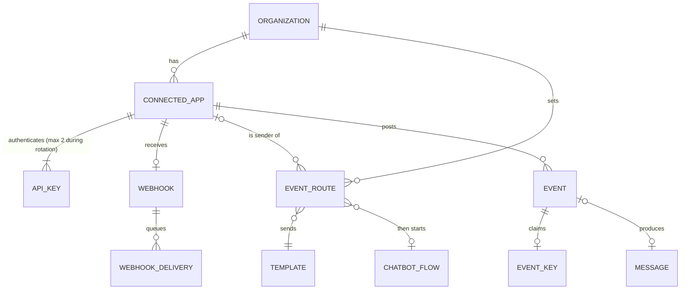
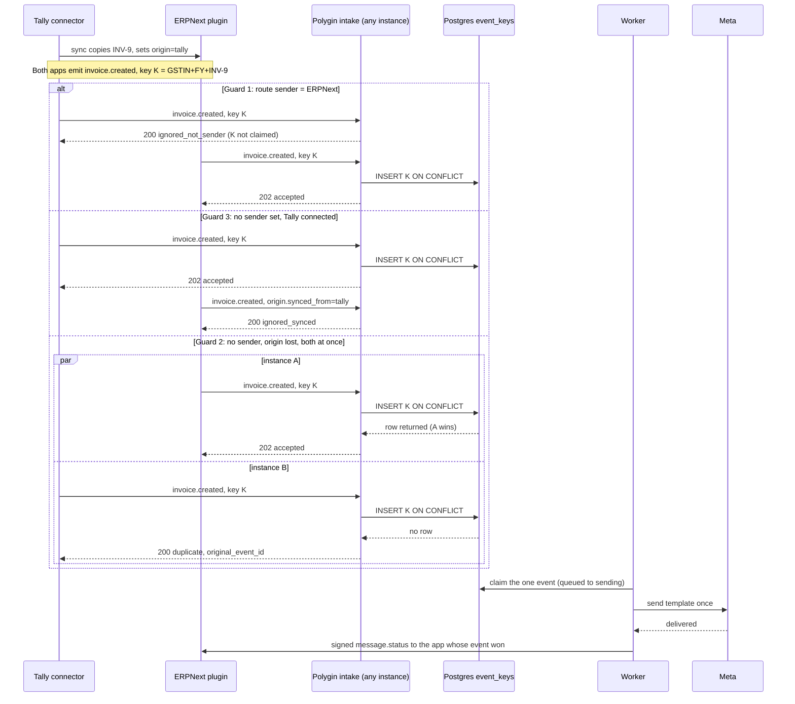
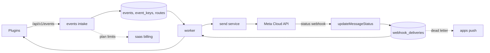

# G1 pack: connect (polygin-saas)
<!-- One page. Requirement IDs INT-01 to INT-05, plus the plugin contract for INT-06 to INT-09. Write only; nothing is built. -->

## A Architecture Vision
- Scope: confirmed bullets in `../../requirements.md` (Confirmed scope). Stakeholders: Superadmin, Admin, plugin authors.
- Constraints: the core stays AGPL-3.0. Plugins are closed programs that use only public API v1. A message goes out once.
- Code checked: API keys inherit the creator's role and have no scopes (`middleware.go:196`). Webhooks retry 3 times in a goroutine and lose the delivery on restart (`webhook_dispatch.go:138`). No `message.status` webhook exists. Webhook secrets are stored in plain text.

## B Business
- Capabilities: connect a business app; send business events; turn an event into a WhatsApp message; return replies and delivery status; drop duplicates.
- Roles: Admin connects, scopes and revokes apps, and sets routes. Superadmin sees usage. A plugin acts as a service principal.
- Process: the app emits an event, then Polygin checks it, then sends one template, then reports status back to the app.

## C Data
| Entity | Reused / Extended / New | Owner | Notes |
|---|---|---|---|
| Organization (tenant), `settings.connect.*` | Reused | core `models.Organization` | Duplicate window and other connect settings live in `Settings` JSONB |
| Plan limits, usage meter | Reused | saas `billing` | Read only. Connect reports accepted events |
| APIKey | Extended | core `api_keys` | Add `connected_app_id`, `scopes`. Empty scopes mean legacy full access |
| Webhook | Extended | core `webhooks` | Add `connected_app_id`. Encrypt `secret` with `internal/crypto`. New events |
| WebhookDelivery | New | connect | Durable outbox: attempts, next try, `dead` state |
| ConnectedApp | New | connect | Tenant, app type, name, status (active, paused, revoked), last seen |
| EventRoute | New | connect | One row per tenant + record type + event. Holds the sender app (guard 1), template, parameter map, optional flow |
| Event | New | connect | Intake log: outcome, state, key hash, `message_id` |
| EventKey | New | connect | Duplicate window (guard 2). Unique on tenant + key hash |
| Record type registry | New (code, not a table) | connect `recordtypes.go` | Key fields per record type. Platform-owned |
| Template, WhatsAppAccount, Contact, Message | Reused | core | Link only. Contact is found or created by phone |
| ChatbotFlow | Extended | core chatbot | Start a flow on the reply to an event's template |
| Origin marker on synced records | Reused | each business app (custom field) | Polygin stores no copy. It arrives in the event |

## C Application
| Capability | Placement | Generic or customer | Why |
|---|---|---|---|
| Connected apps API and page (INT-03) | `internal/events`, `handlers/connected_apps.go`, `views/settings/ConnectedAppsView.vue` | Generic core | Every tenant needs it. Alternative: extend the API keys page (rejected: it hides webhooks and routes) |
| Event intake, guards, routing (INT-04, INT-05) | New package `internal/events`, thin handler `handlers/events.go` | Generic core, setting-driven | G0 named this package. Alternative: all in `handlers` (rejected: already 90 files) |
| Send for an event | Extract the core of `SendTemplateMessage` (`messages.go:662`) into one internal function | Generic core | One send path. No copy |
| Durable webhooks (INT-02) | Extend `webhook_dispatch.go`. Loops run in `internal/worker` | Generic core | Same events, now durable |
| Scopes (INT-01) | Extend `validateAPIKey` and add `RequireScope` middleware | Generic core | Keys today act as their creator |
| Plugins (INT-06 to INT-09) | Own closed repos, one per business app | Generic per business app | AGPL boundary. Customer differences live in routes, not code. No customer app |

**Intake contract** (ADR-041, ADR-042). `POST /api/v1/events`, header `X-API-Key`, scope `events:write`, body at most 64 KB.
- Fields: `schema` (`polygin.event/v1`), `event` (`invoice.created`), `record_type`, `key` (key fields), `occurred_at`, `recipient` (`phone`, `name`), `data`, `origin` (`app`, `record_id`, `synced_from`), `attachments`.
- Key rule: the platform builds the key from the registry. Example: `sales_invoice` uses `gstin + fiscal_year + number`. It trims, uppercases and joins the fields with the record type and the event name, then hashes them with SHA-256. Plugins never build the key.
- Outcomes: `accepted` (202), then `duplicate`, `ignored_not_sender`, `ignored_synced`, `no_route` (200). Each carries `event_id`. A duplicate also carries `original_event_id`. Plugins never retry these.
- Errors: the existing envelope plus `code` and `details[]`. Codes: `invalid_payload` and `unknown_record_type` (422), `scope_missing` and `tenant_suspended` (403), `rate_limited` (429, `Retry-After`), `plan_quota_exceeded` (429).
- Versioning: path `/api/v1`. Additive fields only. A breaking change gets `/api/v2` and a 12-month overlap.
- Rate limits (ADR-048): requests per minute per connected app and events per month per tenant come from the plan. Max connected apps per plan is checked at create time.

**Guards, in order** (ADR-045). (1) If the route has a sender and the caller is another app, drop: `ignored_not_sender`. (3) If no sender is set and `origin.synced_from` names another active connected app, drop: `ignored_synced`. (2) Insert the key atomically. On conflict inside the window, drop: `duplicate`. A dropped event never claims the key.
- Duplicate check (ADR-043): PostgreSQL table `event_keys`. `INSERT ... ON CONFLICT DO UPDATE ... WHERE expires_at < now() RETURNING id`. One statement, so two instances cannot both win. Window: 30 days by default, 1 to 90 per tenant. A sweeper deletes expired rows. Redis is not used: its rate limiter fails open.
- Send once (ADR-046): the key and the event commit in one transaction. The worker claims `queued` to `sending` with `FOR UPDATE SKIP LOCKED`. A crash during `sending` moves the event to `needs_review`, never to an automatic resend.

**Outbound webhooks** (ADR-047). Events: existing ones, plus `message.status`, `event.processed`, `event.failed`. `message.incoming` gains `related_event_id` when the reply quotes an event's message. Signing: keep `X-Webhook-Signature`. Add `X-Polygin-Delivery-Id`, `X-Polygin-Timestamp` and `X-Polygin-Signature: t=<ts>,v1=<hmac of ts.body>`. Retries: 8 attempts over about 24 h on network errors, 408, 429 and 5xx. Then the delivery is `dead`: Admin can replay it, and `apps` gets a push event.

## D Technology
- Go 1.26, fastglue/fasthttp, GORM on PostgreSQL, Redis, Vue 3 with TonalDepth (rule E25 applies to the page in G2).
- Queues: PostgreSQL outbox tables with `SKIP LOCKED`. Redis pub/sub only wakes the worker; losing it delays, never loses.

## Backward compatibility
- `whm_` keys without scopes keep full creator-role access. New keys use `pgn_`. Both stay valid.
- Existing `/api/...` routes stay unchanged. `/api/v1` aliases the routes plugins use.
- Direct send endpoints keep working. They skip the duplicate check because they carry no business key.
- Webhook payload `{event, timestamp, data}` and `X-Webhook-Signature` stay. New fields and headers are additive. Retries rise from 3 to 8, so receivers must stay idempotent by `delivery_id`.

## Plugin contract (INT-06 to INT-09)
- Use one connected app and its key. Call only `/api/v1`. Send `X-Polygin-Plugin: <app>/<version>`.
- Send registry key fields and `origin`. Write `origin` on every record you create by sync.
- Treat 200 outcomes as final. Honour `Retry-After`. Verify signatures. Dedupe by `X-Polygin-Delivery-Id`.
- You may read `GET /api/v1/connected-apps/me/routes` and skip events that the platform will drop.

## Provides / Needs
- Provides to `apps`: internal events `connect.event.failed`, `connect.delivery.dead`, `connect.app.revoked` for push.
- Provides to `saas`: accepted-event counts per tenant per period.
- Needs from `saas`: plan limits (`events_per_minute`, `events_per_month`, `max_connected_apps`), tenant status.
- Needs from `brand`: the `pgn_` prefix and header names.

## Decisions (ADRs)
All in `../../adr/`. ADR-040: a connected app owns a scoped key and one webhook. ADR-041: intake API v1. ADR-042: the platform computes the business key. ADR-043: duplicate check in PostgreSQL. ADR-044: event routes. ADR-045: guard order and origin rule. ADR-046: at-most-once send. ADR-047: durable signed webhooks. ADR-048: limits from the plan. ADR-049: plugin contract boundary.

## Requirement coverage
| Req ID | exists / extend / new | Owner |
|---|---|---|
| INT-01 | extend (scopes, app link) | core `api_keys`, `middleware` |
| INT-02 | extend (durable, signed v1, new events) | core `webhook_dispatch.go`, `worker` |
| INT-03 | new | connect: API and settings page |
| INT-04 | new | connect `internal/events` |
| INT-05 | new | connect `event_routes` |
| INT-06 to INT-09 | contract only | own plugin packs later |

## Open questions
1. Guard 1 and guard 3 conflict. With sender = ERPNext, a plugin that skips synced records sends nothing. ADR-045 lets the platform apply guard 3 only when no sender is set. Accept this?
2. Is the 30-day default window right? Tally imports of old invoices fall outside it unless origin is set.
3. Do Tally and ERPNext keep the same invoice number and GSTIN after sync? Guard 2 depends on it.
4. Where does the Tally connector run: the desktop helper (APP-02) or its own Windows service on the customer's LAN?
5. Should new keys use the `pgn_` prefix (needs `brand` sign-off)?
