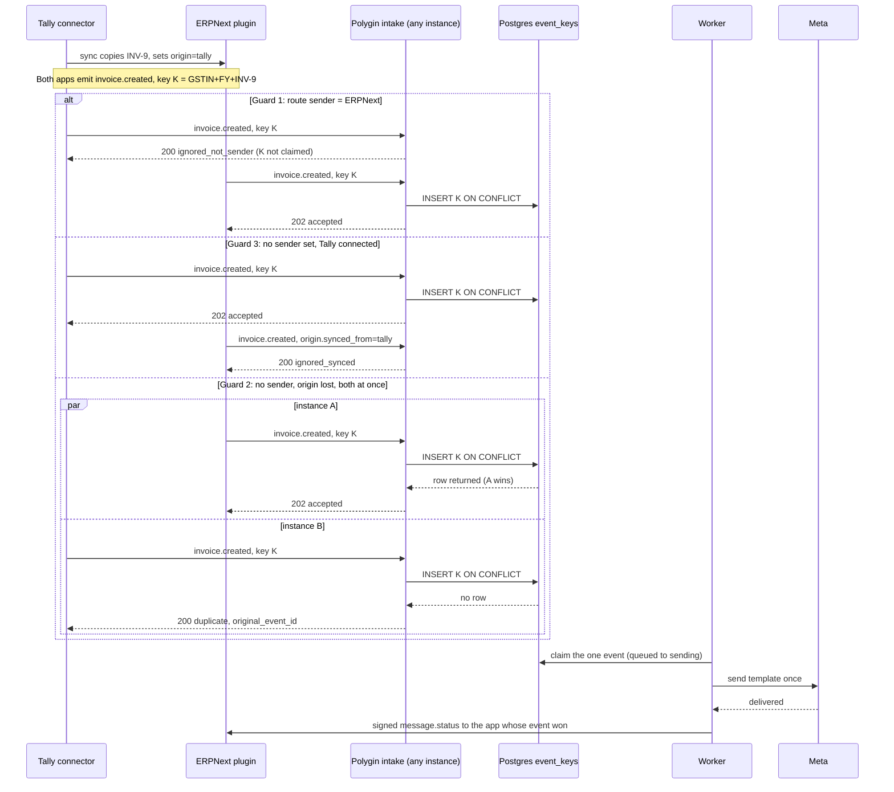

# connect: event intake and plugin contract (polygin-saas)
<!-- Detail for `G1.md`. Requirement IDs INT-01 to INT-09. Status: proposed. Moved out of G1 in the merge pass, 2026-11-19. -->

## C Application: intake contract (ADR-041, ADR-042)
- Route: `POST /api/v1/events`. Header `X-API-Key`. Scope `events:write`. Body at most 64 KB.
- Order of checks: `RequireAccess`, then scope, then the `events_per_min` limiter (ADR-045, ADR-081).
- Fields: `schema` (`polygin.event/v1`), `event` (`invoice.created`), `record_type`, `key` (key fields), `occurred_at`, `recipient` (`phone`, `name`), `data`, `origin` (`app`, `record_id`, `synced_from`), `attachments`.
- Key rule: the platform builds the key from the registry. Example: `sales_invoice` uses `gstin + fiscal_year + number`.
- Normalising: trim, uppercase, collapse inner spaces, keep leading zeros. Then SHA-256 over `record_type | event | fields`, scoped to the tenant. Plugins never build the key.
- Outcomes: `accepted` (202). `duplicate`, `ignored_not_sender`, `ignored_synced`, `no_route` (200). Each carries `event_id`. A duplicate also carries `original_event_id`. Plugins never retry these.
- Errors use the shared envelope with `code` and `details[]` (ADR-082):
  - 422 `invalid_payload`, `unknown_record_type`.
  - 402 `plan_limit_reached`, key `events_in`. Final: the plugin stops and alerts.
  - 403 `scope_missing`, `tenant_suspended`, `tenant_blocked`. Final.
  - 429 `rate_limited` with `Retry-After`. Retry after the wait.
- Usage: each `accepted` event calls billing `Consume(org, events_in, 1)`. Dropped events consume nothing. The send also consumes `messages_out` (ADR-081).
- Versioning: path `/api/v1`. Additive fields only. A breaking change gets `/api/v2` and a 12-month overlap. OpenAPI file in G3.

## C Application: guards, in order (ADR-045)
1. Guard 1. If the route has a sender and the caller is another app, drop: `ignored_not_sender`.
2. Guard 3. Only when no sender is set: if `origin.synced_from` names another active connected app, drop: `ignored_synced`.
3. Guard 2. Insert the key atomically. On conflict inside the window, drop: `duplicate`.
- A dropped event never claims the key.
- Duplicate check (ADR-043): table `event_keys`. `INSERT ... ON CONFLICT DO UPDATE ... WHERE expires_at < now() RETURNING id`. One statement, so two instances cannot both win.
- Window: 30 days by default, 1 to 90 in `Organization.Settings.connect.dedupe_window_days`. A sweeper deletes expired rows. Redis is not used.
- Send once (ADR-046): the key and the event commit in one transaction. The worker claims `queued` to `sending` with `FOR UPDATE SKIP LOCKED`. A crash during `sending` moves the event to `needs_review`, never to a resend.

## C Application: outbound webhooks (ADR-047)
- Events: existing ones, plus `message.status`, `event.processed`, `event.failed`.
- `message.incoming` gains `related_event_id` when the reply quotes an event's message.
- `message.status` and `event.*` go only to the app whose event produced the message, plus legacy webhooks that subscribe.
- Signing: keep `X-Webhook-Signature`. Add `X-Polygin-Delivery-Id`, `X-Polygin-Timestamp` and `X-Polygin-Signature: t=<ts>,v1=<hmac of ts.body>` (ADR-087).
- Secrets: generated by the platform, encrypted with `internal/crypto`, never shown during impersonation.
- Retries: 8 attempts over about 24 h on network errors, 408, 429 and 5xx. Then `dead`. Admin can replay it.
- Alerts: `connect.delivery.dead`, `connect.webhook.paused`, `connect.event.failed`, `connect.app.revoked` through `push.Enqueue` (ADR-084).

## Backward compatibility
- `whm_` keys without scopes keep full creator-role access. New keys use `pgn_` and scopes only (ADR-085, ADR-087).
- Existing `/api/...` routes stay unchanged. `/api/v1` aliases the routes plugins use.
- Direct send endpoints keep working. They skip the duplicate check because they carry no business key.
- Webhook payload `{event, timestamp, data}` and `X-Webhook-Signature` stay. New fields and headers are additive.
- Retries rise from 3 to 8, so receivers must stay idempotent by delivery ID.

## Plugin contract (INT-06 to INT-09, ADR-049)
- Use one connected app and its key. Call only `/api/v1`. Send `X-Polygin-Plugin: <app>/<version>`.
- Send registry key fields and `origin`. Write `origin` on every record you create by sync.
- Treat 200 outcomes, 402 and 403 as final. Honour `Retry-After` on 429.
- Verify `X-Polygin-Signature`. Reject timestamps older than 5 minutes. Dedupe by `X-Polygin-Delivery-Id`.
- You may read `GET /api/v1/connected-apps/me/routes` (scope `routes:read`) and skip events the platform will drop.
- Scopes: `events:write`, `messages:send`, `templates:read`, `contacts:read`, `contacts:write`, `routes:read`.
