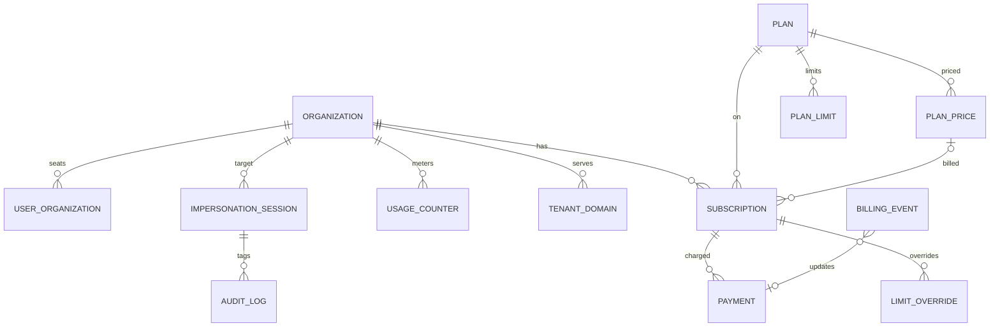
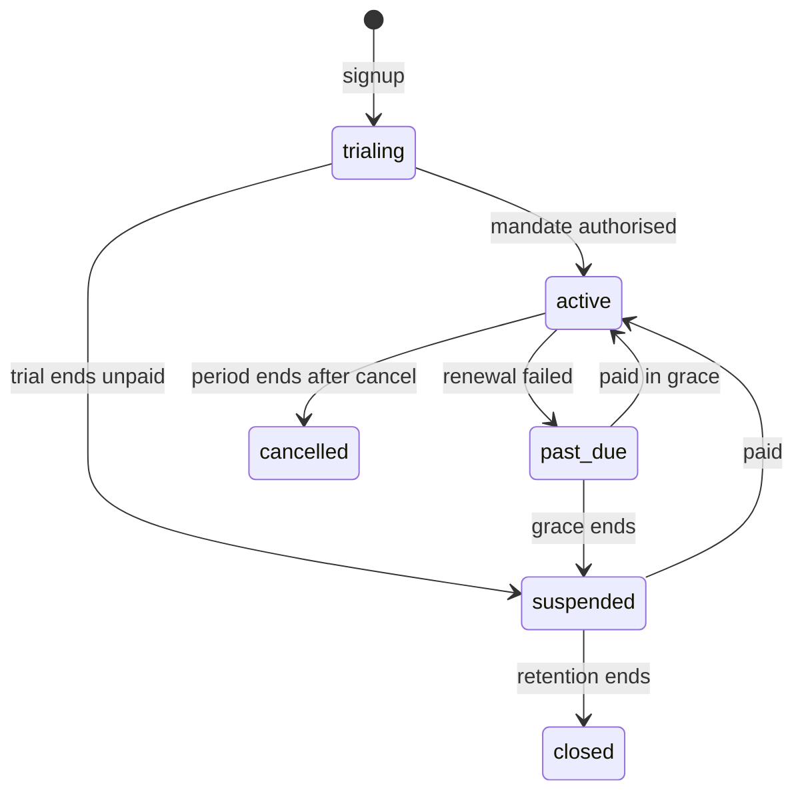

# G1 pack: saas (polygin-saas)
<!-- One page. Route architecture, floor money. Status: proposed, awaiting approval. Covers SAAS-01 to SAAS-10. Merged 2026-11-19 with `../../data-model.md` and `../../contracts.md`. -->

## A Architecture Vision
- Scope: `requirements.md` rows SAAS-01 to SAAS-10, SEC-01, SEC-02, SEC-08 to SEC-11, SEC-14; decisions D2 and D4. Roles: Superadmin, Admin, Agent.
- Constraints: Go fork, AGPL-3.0 core, `app.polyg.in`, Cashfree on the web only, no data from the old polyg.in.
- Assumption: Admin and Agent map to the seeded system roles `admin` and `agent`. The `manager` role stays optional.
- Detailed contracts: `contract.md` (limit keys, errors, endpoints, Cashfree flow, isolation risks).

## B Business
| Role | Capabilities |
|---|---|
| Superadmin | List tenants with plan, status and usage. Suspend, block, reopen. Assign a plan by hand with a contract reference (SAAS-09). Override one limit. Impersonate with a reason. Manage plans and prices. |
| Admin | Sign up and create the tenant. Invite members. Start a trial. Buy, change or cancel a plan. Pay a failed renewal. See usage. Set logo, colours and custom domain. See impersonation sessions in the audit log. |
| Agent | Work inside the plan limits. See a banner when the tenant is in grace or suspended. |

Processes: signup to trial; invite to join; trial to paid; renewal; failed payment to grace to suspension to reopen; bundled contract; impersonation.

## C Data
New GORM models live in `internal/models`, like every fork model. The owner column names the only package that writes them.

| Entity | Mark | Owner | Notes |
|---|---|---|---|
| Organization | Extended | fork `models/models.go` | Tenant. Add `access_state` (active, suspended, blocked, closed), `access_reason`, `access_changed_at`. `Name` is the brand display name. |
| `Organization.Settings.branding.*` | Extended | `handlers/branding.go` | Payload shape from brand-ui (ADR-083). No product name stored. |
| User, `IsSuperAdmin` | Reused | fork `models/models.go` | Platform owner flag. No new role table. |
| UserOrganization | Reused | fork `models/models.go` | Seat count source. No copied counter. |
| CustomRole, Permission | Reused | fork `models/roles.go` | Add resources `billing`, `branding`. |
| AuditLog | Extended | fork `internal/audit` | Add nullable `impersonation_session_id`. |
| Plan, PlanPrice, PlanLimit | New | fork `internal/billing` | Limits and feature flags share one key registry. Prices in integer paise, INR. |
| Subscription | New | `internal/billing` | One open row per tenant. Source: trial, cashfree or manual. Price snapshot. |
| LimitOverride | New | `internal/billing` | Per-subscription limit set by the Superadmin, with a reason. |
| UsageCounter | New | `internal/billing` | Metered keys only, per tenant per month. The only usage source. |
| Payment | New | `internal/billing` | Gateway record only. Accounting stays outside (open question S2). |
| BillingEvent | New | `internal/billing` | Cashfree webhook inbox. Unique provider event ID. |
| ImpersonationSession | New | fork `handlers/platform_*.go` | Reason, mode, expiry, end time. |
| TenantDomain | New | fork `handlers/branding.go` | Unique hostname, DNS check state. |
| Invite and verification tokens | New, transient | fork `handlers/auth.go` | Signed, single use. |

## C Application
| Capability | Placement | Generic or customer | Why |
|---|---|---|---|
| Tenancy, roles (SAAS-01, 02) | exists: `middleware.go`, `models/roles.go` | generic | Already scoped by `organization_id`. |
| Access gate | new `RequireAccess` in `middleware.go` | generic | One place resolves the tenant and its `access_state`. |
| Plans, limits, metering (SAAS-04) | new package `internal/billing` | generic, setting-driven | No owner exists. Alt: closed service; AGPL rules it out (ADR-001). |
| Cashfree (SAAS-05) | `internal/billing/cashfree`, plain REST | generic | Medusa plugin is Medusa-only (ADR-004). |
| Signup, invites (SAAS-06, SEC-01) | extend `handlers/auth.go`, `RegisterView.vue` | generic | Reuse `CreateOrganization` seeding (ADR-009). |
| Branding, domains (SAAS-07) | new `handlers/branding.go`; keys in `Organization.Settings` | generic | ADR-010, ADR-083. |
| Superadmin console, impersonation (SAAS-03, SEC-02) | new `handlers/platform_*.go`, views `platform/` | generic | ADR-008. |
| Manual plan (SAAS-09) | `internal/billing` source `manual` | generic | ADR-007. |
| Billing views, grace and read-only banner | new views `billing/`, shell banner slot | generic | Shown in browsers and shells. Hide buying in a phone shell (ADR-065). |
| Transactional email (SAAS-10) | new mail sender, placement after open question S5 | generic | Verify, invite, billing and Superadmin notices. Uses `{appName}`. |
| AGPL link (SAAS-08) | brand-ui shell footer | generic | brand-ui owns it (ADR-083). |

## D Technology
- Same binary, PostgreSQL 17, Redis 7. Meters use an atomic Redis check-and-increment. A ticker flushes them to `UsageCounter` each minute.
- A `billing` ticker runs grace expiry and reconcile every 15 min. A Redis lock keeps it to one instance.
- Cashfree Subscriptions API for mandates (UPI AutoPay, card, eNACH). Cashfree PG orders for one-off payments.
- Secrets come from env vars: Cashfree app ID, secret, webhook secret (E10).
- Custom domains need a TLS proxy with on-demand certificates (open question S6).

Suspended means read-only: login, view, export and billing work. Outbound sends, campaigns, event intake and calls stop. Inbound messages are still stored (ADR-006). `blocked` is a Superadmin action and stops all tenant logins.

## Provides / Needs (checked in `../../contracts.md`)
- Provides P1: billing service `Limit`, `Feature`, `Headroom`, `Consume`, with the limit cache (ADR-081).
- Provides P2: limit key registry. Owning modules register counter and purge functions.
- Provides P3: shared error codes (ADR-082).
- Provides P4: `GET /api/billing/summary`. P5: WebSocket and push `billing.access_changed`.
- Provides P6: `GET /api/public/branding` by host, `GET /api/branding` by session org, injection in `embed.go` on custom domains.
- Provides P7: impersonator in request context, and the impersonation guard (ADR-085).
- Needs N1 from `brand-ui`: branding payload shape, `applyBranding`, contrast guard, TdColorPicker, shell footer.
- Needs N2 from `connect`: `Consume(events_in)`; the `connected_apps` counter; a purge function.
- Needs N3 from `apps`: the bridge adapter's shell flag; `push.Enqueue`; a purge function for devices.

## Decisions (ADRs)
ADR-001 billing in AGPL core. ADR-002 access state owner. ADR-003 entitlements and metering. ADR-004 Cashfree integration. ADR-005 webhooks and reconcile. ADR-006 grace and suspension. ADR-007 manual plans. ADR-008 impersonation. ADR-009 signup and joining. ADR-010 branding and domains. ADR-011 money handling. Cross-cutting: ADR-080 to ADR-087. See `../../adr/`.

## Requirement coverage
| Req ID | Mark | Owner |
|---|---|---|
| SAAS-01 | exists | `Organization`, `middleware.go`; extend `access_state` |
| SAAS-02 | exists | `models/roles.go` |
| SAAS-03 | extend | `IsSuperAdmin`; new `handlers/platform_*.go`, `ImpersonationSession` |
| SAAS-04 | new | `internal/billing` |
| SAAS-05 | new | `internal/billing/cashfree` |
| SAAS-06 | extend | `handlers/auth.go`, `RegisterView.vue` |
| SAAS-07 | new | `Organization.Settings.branding`, `TenantDomain` |
| SAAS-08 | new | brand-ui shell footer |
| SAAS-09 | new | `internal/billing` source `manual` |
| SAAS-10 | new | mail sender (open question S5) |
| SEC-01, 02, 08 to 11, 14 | extend / new | see `contract.md`, isolation risks |

## Open questions
See `../../open-questions.md`, group saas (S1 to S9).
