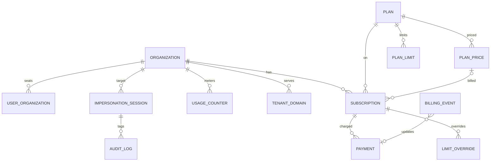
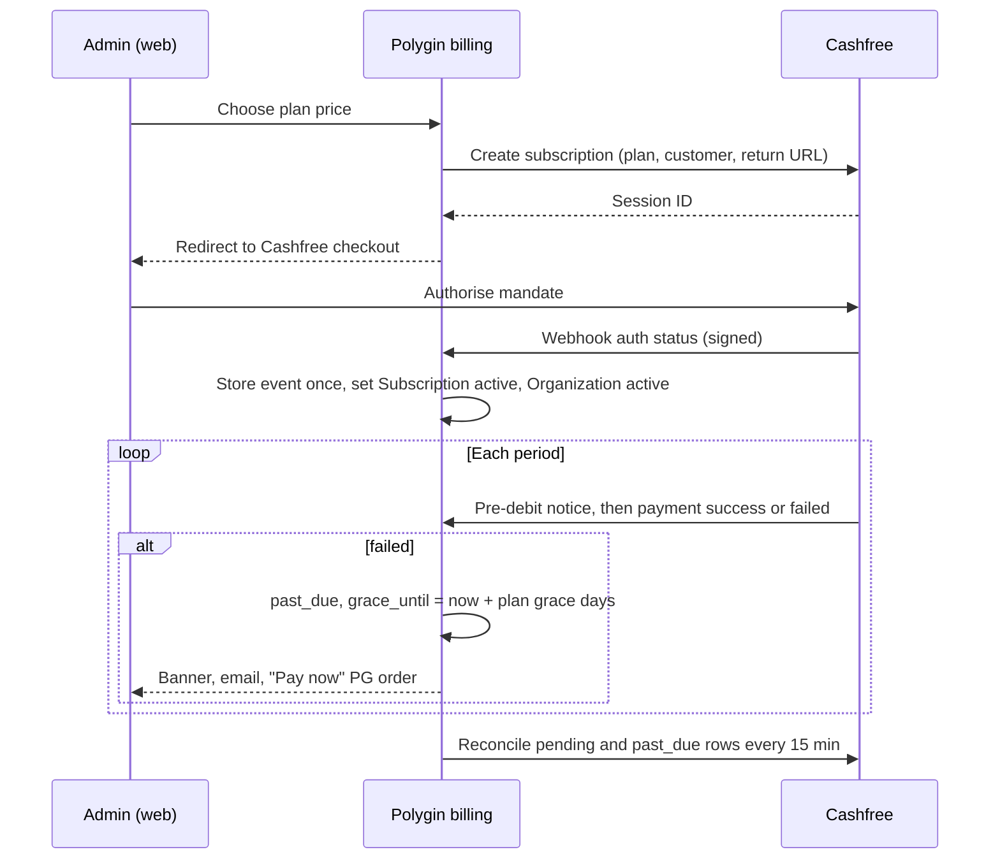
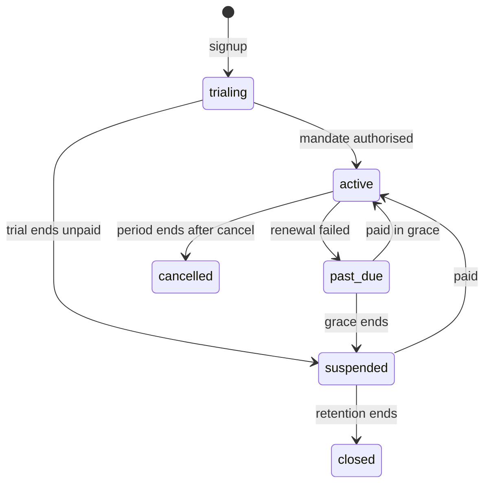

# G1 pack: saas (polygin-saas)
<!-- Route architecture, floor money. Status: proposed, awaiting approval. Covers SAAS-01 to SAAS-09. -->

## A Architecture Vision
- Scope: `requirements.md` rows SAAS-01 to SAAS-09, decisions D2 and D4. Roles: Superadmin, Admin, Agent.
- Constraints: Go fork, AGPL-3.0 core, `app.polyg.in`, Cashfree on the web only, no data from the old polyg.in.
- Assumption: Admin and Agent map to the seeded system roles `admin` and `agent`. The `manager` role stays optional.

## B Business
| Role | Capabilities |
|---|---|
| Superadmin | List tenants with plan, status and usage. Suspend, block, reopen. Assign a plan by hand with a contract reference (SAAS-09). Override one limit. Impersonate with a reason. Manage plans and prices. |
| Admin | Sign up and create the tenant. Start a trial. Buy, change or cancel a plan. Pay a failed renewal. See usage. Set logo, colours and custom domain. See impersonation sessions in the audit log. |
| Agent | Work inside the plan limits. See a banner when the tenant is in grace or suspended. |

Processes: signup to trial; trial to paid; renewal; failed payment to grace to suspension to reopen; bundled contract; impersonation.

## C Data
New GORM models live in `internal/models`, like every fork model. The owner column names the only package that writes them.

| Entity | Mark | Owner | Notes |
|---|---|---|---|
| Organization | Extended | fork `models/models.go` | Tenant. Add `access_state` (active, suspended, blocked, closed), `access_reason`, `access_changed_at`. Branding keys go in `Settings.branding`. |
| User, `IsSuperAdmin` | Reused | fork `models/models.go` | Platform owner flag. No new role table. |
| UserOrganization | Reused | fork `models/models.go` | Seat count source. No copied counter. |
| CustomRole, Permission | Reused | fork `models/roles.go` | Add resources `billing`, `branding`. |
| AuditLog | Extended | fork `internal/audit` | Add nullable `impersonation_session_id`. |
| Plan, PlanPrice, PlanLimit | New | fork `internal/billing` | Limits and feature flags share one key registry. Prices in integer paise, INR. |
| Subscription | New | `internal/billing` | One open row per tenant. Source: trial, cashfree or manual. Price snapshot. |
| LimitOverride | New | `internal/billing` | Per-subscription limit set by the Superadmin, with a reason. |
| UsageCounter | New | `internal/billing` | Metered keys only, per tenant per month. |
| Payment | New | `internal/billing` | Gateway record only. Accounting stays outside (open question 2). |
| BillingEvent | New | `internal/billing` | Webhook inbox. Unique provider event ID. |
| ImpersonationSession | New | fork `handlers/platform_*.go` | Reason, mode, expiry, end time. |
| TenantDomain | New | fork `handlers/branding.go` | Unique hostname, DNS check state. |

## C Application
| Capability | Placement | Generic or customer | Why |
|---|---|---|---|
| Tenancy, roles (SAAS-01, 02) | exists: `middleware.go`, `models/roles.go` | generic | Already scoped by `organization_id`. |
| Access gate | new `RequireAccess` in `middleware.go` | generic | One place resolves the tenant and its `access_state`. |
| Plans, limits, metering (SAAS-04) | new package `internal/billing` | generic, setting-driven | No owner exists. Alt: closed service; AGPL rules it out (ADR-001). |
| Cashfree (SAAS-05) | `internal/billing/cashfree`, plain REST | generic | Medusa plugin is Medusa-only (ADR-004). |
| Signup (SAAS-06) | extend `handlers/auth.go`, `RegisterView.vue` | generic | Reuse `CreateOrganization` seeding (ADR-009). |
| Branding, domains (SAAS-07) | new `handlers/branding.go`; keys in `Organization.Settings` | generic | ADR-010. |
| Superadmin console, impersonation (SAAS-03) | new `handlers/platform_*.go`, views `platform/` | generic | ADR-008. |
| Manual plan (SAAS-09) | `internal/billing` source `manual` | generic | ADR-007. |
| AGPL link (SAAS-08) | frontend footer, from `brand` module | generic | Links to the running commit. |

Limit enforcement. All calls go through one `billing` service. Count limits read their source table.
| Key | Kind | Enforced at |
|---|---|---|
| `seats` | count of `user_organizations` | `users.go` create, `AddOrganizationMember`, invite accept |
| `wa_accounts` | count of `whatsapp_accounts` | `accounts.go` create, `coexistence.go` signup |
| `messages_out` | monthly meter | `messages.go` send, `campaigns.go` start (pre-check), `worker.go` per send |
| `ai_minutes` | monthly meter | `internal/calling` session end; `feature.calling` gates `calling_enabled` |
| `events_in`, `connected_apps` | meter, count | `connect` module (contract below) |
| `feature.*` | flag | route middleware: sso, calling, ai, api_keys, branding, custom_domain |

## D Technology
- Same binary, PostgreSQL 17, Redis 7. Meters use an atomic Redis check-and-increment. A ticker flushes them to `UsageCounter` each minute.
- A `billing` ticker runs grace expiry and reconcile every 15 min. A Redis lock keeps it to one instance.
- Cashfree Subscriptions API for mandates (UPI AutoPay, card, eNACH). Cashfree PG orders for one-off payments.
- Webhook `POST /api/billing/webhooks/cashfree`: public route, HMAC signature check, idempotent inbox (ADR-005).
- Secrets come from env vars: Cashfree app ID, secret, webhook secret (E10).
- Custom domains need a TLS proxy with on-demand certificates (open question 6).

Suspended means read-only: login, view, export and billing work. Outbound sends, campaigns and calls stop. Inbound messages are still stored (ADR-006). `blocked` is a Superadmin action and stops all tenant logins.

Tenant isolation risks:
1. `Register` adds any caller to any tenant by organization UUID (`auth.go:110`). Close it to invite tokens (ADR-009).
2. A Superadmin enters any tenant silently through `X-Organization-ID` (`app.go:84`) and `SwitchOrg`. Replace with audited sessions (ADR-008).
3. Isolation relies on `organization_id` filters across about 710 query sites. Add a two-tenant test over every endpoint. Postgres RLS is deferred.
4. `OrganizationContext` loads the JWT org, but handlers may use the header org. `RequireAccess` must check the resolved org.
5. A custom domain must match the session's org, or the request fails. Certificates issue only for verified domains.
6. Webhooks map to a tenant from our stored Cashfree ID, never from payload notes. Redis keys carry the org ID.

## Provides / Needs
- Provides P1: `billing` service with four calls: read a limit, check a feature, check headroom, consume atomically.
- Provides P2: limit key registry in `internal/billing/keys.go`. Billing owns keys. Each module owns the records counted.
- Provides P3: errors. HTTP 402 `plan_limit_reached` (key, limit, used). HTTP 403 `plan_feature_off`, `tenant_suspended`, `tenant_blocked`.
- Provides P4: `GET /api/billing/summary` for any member: plan, status, access state, period end, grace end, limits, usage, web buy URL. `apps` reads this (APP-04).
- Provides P5: WebSocket event `billing.access_changed` through the existing org hub.
- Provides P6: `GET /api/public/branding` by host, and the impersonator ID in request context.
- Needs N1 from `brand`: tenant accent as TonalDepth token overrides with a contrast check; footer with the AGPL link and build commit.
- Needs N2 from `connect`: call consume for `events_in`; count `connected_apps` from its table.
- Needs N3 from `apps`: show the summary, open the web to buy, handle the 402 and 403 codes.

## Decisions (ADRs)
ADR-001 billing in AGPL core. ADR-002 access state owner. ADR-003 entitlements and metering. ADR-004 Cashfree integration. ADR-005 webhooks and reconcile. ADR-006 grace and suspension. ADR-007 manual plans. ADR-008 impersonation. ADR-009 signup and joining. ADR-010 branding and domains. ADR-011 money handling. See `../../adr/`.

## Requirement coverage
| Req ID | Mark | Owner |
|---|---|---|
| SAAS-01 | exists | `Organization`, `middleware.go`; extend `access_state` |
| SAAS-02 | exists | `models/roles.go` |
| SAAS-03 | extend | `IsSuperAdmin`; new `handlers/platform_*.go`, `ImpersonationSession` |
| SAAS-04 | new | `internal/billing` |
| SAAS-05 | new | `internal/billing/cashfree` |
| SAAS-06 | extend | `handlers/auth.go`, `RegisterView.vue` |
| SAAS-07 | new | `Organization.Settings.branding`, `TenantDomain` |
| SAAS-08 | new | frontend footer (`brand`) |
| SAAS-09 | new | `internal/billing` source `manual` |

## Open questions
1. Upgrade mid-period: charge the prorated difference as a one-off order (Recommended), or start a new full period?
2. Tax invoices and GST: push each paid Payment to Mithtech's ERPNext as a Sales Invoice (Recommended), or build invoices in Polygin?
3. Monthly message limit reached: block campaigns and keep 1:1 replies (Recommended), hard block everything, or paid overage?
4. Timeline: grace 7 days, read-only 30 days, then close and delete data after 90 more days? Confirm or change.
5. No email exists in the fork. Use SMTP through Go stdlib with a provider account (Recommended), or WhatsApp notices only?
6. Custom domain TLS: Caddy on-demand TLS in front of the binary (Recommended), or Cloudflare for SaaS? Either needs approval (E23).
7. Superadmin login: add TOTP for Superadmins (Recommended), or require SSO only?
8. Plan catalogue: supply names, prices and limits for each plan.
9. Impersonation: read-only by default with write mode on a second reason (Recommended), or full write always?
