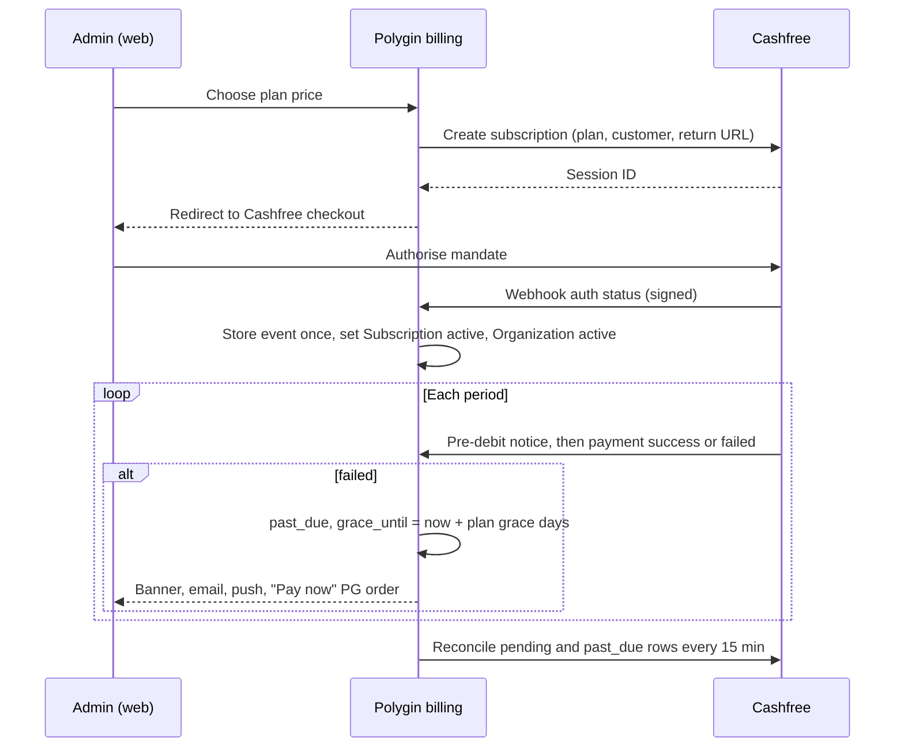

# saas: entitlement, billing and isolation contract (polygin-saas)
<!-- Detail for `G1.md`. Requirement IDs SAAS-03 to SAAS-09, SEC-01, SEC-02, SEC-08 to SEC-11, SEC-14. Status: proposed. Moved out of G1 in the merge pass, 2026-11-19. -->

## C Application: billing service (ADR-003, ADR-081)
- Four calls: `Limit(org, key)`, `Feature(org, key)`, `Headroom(org, key, n)`, `Consume(org, key, n)`.
- Billing owns the key registry (`internal/billing/keys.go`) and the 60 s limit cache.
- Count keys: the owning module registers a counter function. Billing never queries another module's table.
- Meters fail open when Redis is down. The miss is logged and reconciled (open question X3).
- Each module registers a tenant purge function. Billing calls them when a tenant moves to `closed`.

| Key | Kind | Counter or enforcement site |
|---|---|---|
| `seats` | count of `user_organizations` | core counter. `users.go` create, `AddOrganizationMember`, invite accept |
| `wa_accounts` | count of `whatsapp_accounts` | core counter. `accounts.go` create, `coexistence.go` signup |
| `connected_apps` | count of non-revoked `connected_apps` | connect counter. Connected app create |
| `messages_out` | monthly meter | the shared send function: `messages.go`, `campaigns.go` pre-check, `worker.go`, event sends |
| `ai_minutes` | monthly meter | `internal/calling` session end |
| `events_in` | monthly meter | connect, once per `accepted` event |
| `events_per_min` | rate | connect limiter, per connected app |
| `feature.*` | flag | route middleware: sso, calling, ai, api_keys, branding, custom_domain. `feature.calling` gates `calling_enabled` |

## C Application: errors and endpoints (ADR-082)
- 402 `plan_limit_reached`, `details`: key, limit, used.
- 403 `plan_feature_off`, `tenant_suspended`, `tenant_blocked`, `impersonation_forbidden`.
- `GET /api/billing/summary` for any member: plan, status, access state, period end, grace end, limits, usage, web buy URL. Phone shells hide the buy URL (ADR-065).
- WebSocket `billing.access_changed` through the org hub. Push `billing.access_changed` to members with `billing` (ADR-084).
- `GET /api/public/branding` by host. `GET /api/branding` by session org (ADR-083).
- Request context carries the impersonator ID and session ID. The audit writer reads them (ADR-086).
- `POST /api/billing/webhooks/cashfree`: public route, HMAC check, idempotent inbox (ADR-005).

## D Technology: Cashfree flow (ADR-004, ADR-005)

## Tenant isolation risks (SEC series)
1. `Register` adds any caller to any tenant by organization UUID (`auth.go:110`). Close it to invite tokens (ADR-009, SEC-01).
2. A Superadmin enters any tenant silently through `X-Organization-ID` (`app.go:84`) and `SwitchOrg`. Replace with audited sessions (ADR-008, SEC-02).
3. Isolation relies on `organization_id` filters across about 710 query sites. Add a two-tenant test over every endpoint (SEC-08). Postgres RLS is deferred.
4. `OrganizationContext` loads the JWT org, but handlers may use the header org. `RequireAccess` must check the resolved org.
5. A custom domain must match the session's org, or the request fails. Certificates issue only for verified domains (SEC-09).
6. Webhooks map to a tenant from our stored Cashfree ID, never from payload notes. Redis keys carry the org ID (SEC-10).
